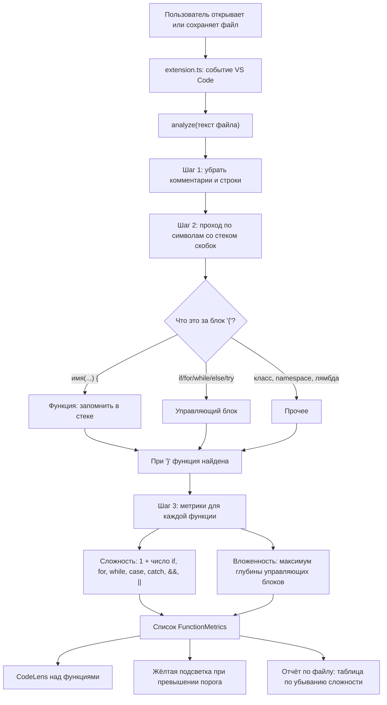

# Документация Complexity Lens

## 1. Общая идея

Расширение разделено на две независимые части:

- **`analyzer.ts`** — «мозг». Получает текст файла и возвращает список функций с метриками. Не обращается к VS Code, поэтому его можно тестировать отдельно, обычным Node.js.
- **`extension.ts`** — «оболочка». Подключает анализатор к редактору: рисует CodeLens, подсвечивает строки, добавляет команду и следит за событиями.

## 2. Блок-схема

## 3. Алгоритм анализатора

### Шаг 1. Очистка текста

`stripCommentsAndStrings` заменяет содержимое комментариев (`//`, `/* */`) и строковых литералов (`"..."`, `'...'`, `` `...` ``) пробелами. Длина текста и переводы строк сохраняются, поэтому позиции символов не сдвигаются. Благодаря этому слова вроде `if` или `&&` внутри строк и комментариев не попадают в подсчёт.

### Шаг 2. Поиск функций через стек скобок

Анализатор проходит по очищенному тексту. На каждой `{` вызывается `classifyBrace`, которая смотрит на текст **перед** скобкой и определяет, что открывается:

| Что стоит перед `{` | Вердикт |
|---|---|
| `имя(...)`, возможно с `const`, `noexcept`, `throws ...`, `: Тип`, `-> Тип` | функция |
| `ключевое_слово(...)`, где слово — `if`, `for`, `while`, `switch`, `catch` и т. п., либо `else`, `do`, `try`, `finally` | управляющий блок |
| `имя = (...) =>` | стрелочная функция с именем |
| список инициализации C++: `Foo() : a(1), b(2)` | конструктор (`resolveInitList` находит имя `Foo`) |
| всё остальное (`class X`, `namespace`, объект, лямбда, анонимный колбэк) | прочее |

На стек кладётся либо найденная функция, либо пустое значение. На каждой `}` верхний элемент снимается со стека; если это была функция, она записывается в результат вместе с позициями начала и конца тела.

### Шаг 3. Метрики

`computeMetrics` для тела каждой функции считает:

- **Цикломатическая сложность** = `1 + число совпадений` регулярного выражения по словам `if`, `for`, `while`, `case`, `catch` и операторам `&&`, `||`. Слова распознаются как отдельные (не части идентификаторов, не после `.` или `#`).
- **Максимальная вложенность**: второй проход по скобкам со стеком. Каждая `{` управляющего блока увеличивает текущую глубину, парная `}` уменьшает; результат — наибольшая достигнутая глубина.

Если внутри функции есть другая именованная функция (например, стрелочная), её сложность входит и в собственную строку, и в итог внешней.

## 4. Справочник по коду

### `analyzer.ts`

| Элемент | Назначение |
|---|---|
| `FunctionMetrics` | Интерфейс результата: `name`, `line`, `endLine`, `complexity`, `maxNesting`. |
| `stripCommentsAndStrings(src)` | Шаг 1: очистка от комментариев и строк с сохранением позиций. |
| `classifyBrace(text, pos)` | Определяет тип блока по тексту перед `{`. |
| `findMatchingOpen(text, closeIdx, open, close)` | Поиск парной открывающей скобки назад. |
| `resolveInitList(s)` | Находит имя конструктора C++ по списку инициализации. |
| `buildLineStarts`, `offsetToLine` | Перевод позиции символа в номер строки (бинарный поиск). |
| `computeMetrics(text, fn)` | Шаг 3: сложность и вложенность одной функции. |
| `analyze(source)` | Главная функция: текст файла → отсортированный по строкам список `FunctionMetrics`. |

### `extension.ts`

| Элемент | Назначение |
|---|---|
| `SUPPORTED_LANGUAGES` | Языки, для которых расширение активно. |
| `cache` | Кэш результатов анализа по адресу документа; обновляется только при сохранении. |
| `refresh(doc)`, `getMetrics(doc)` | Пересчёт и чтение из кэша. |
| `updateDecorations(editor)` | Жёлтая подсветка функций выше порога. |
| `ComplexityLensProvider` | Провайдер CodeLens: строка метрик над функцией. |
| `showReport(output)` | Команда отчёта: таблица в панели Output. |
| `activate(context)` | Регистрация команды, CodeLens и обработчиков событий. |
| `deactivate()` | Очистка кэша при выключении. |

## 5. Манифест `package.json`

- `activationEvents` — расширение включается при открытии файла на поддерживаемом языке (`onLanguage:...`).
- `contributes.commands` — объявляет команду `complexity-lens.showReport`. Идентификатор должен буквально совпадать с тем, что передаётся в `registerCommand` в `extension.ts`.
- `contributes.configuration` — объявляет настройку `complexityLens.threshold`.
- `main` — путь к скомпилированной точке входа `./out/extension.js`.

## 6. События и пересчёт

| Событие VS Code | Реакция |
|---|---|
| `onDidSaveTextDocument` | Пересчёт метрик файла, обновление CodeLens и подсветки. |
| `onDidChangeActiveTextEditor` | Обновление подсветки в открывшемся редакторе. |
| `onDidChangeConfiguration` | Перерисовка при смене порога. |
| `onDidCloseTextDocument` | Удаление результата из кэша. |

Все регистрации складываются в `context.subscriptions`, чтобы VS Code освободил их при выключении расширения.

## 7. Ограничения

- Анализ эвристический, это не полноценный парсер языка.
- `if`/`for`/`while` без фигурных скобок учитываются в сложности, но не во вложенности.
- Тернарный оператор `?:` в сложность не входит.
- Анонимные колбэки и лямбды считаются частью внешней функции.
- CodeLens в VS Code нельзя раскрасить, поэтому предупреждение отображается жёлтой подсветкой строки функции и значком ⚠ в метрике.
